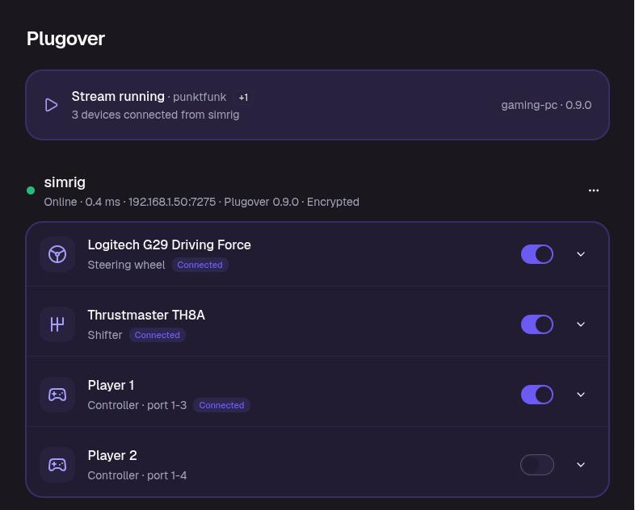
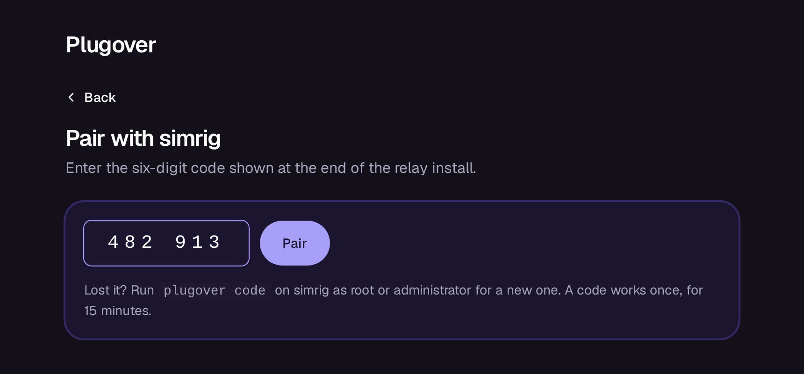

# Plugover

Plug your wheel, pedals or controller into the computer next to you and play with it on a gaming
PC elsewhere in the house, the one you stream from.

Plugover forwards the real USB device over your network (USB/IP), so force feedback and vendor
features keep working. Devices connect when a stream starts and go back when it ends.




The **relay** is the machine the devices are plugged into. The **host** is the gaming PC, where
games see them as local devices.

## Install

Run the installer on the relay first, then on the host, and pick the role when it asks.

```sh
# Linux, as your normal user
curl -fsSL https://github.com/wiktorekdev/plugover/releases/latest/download/installer.sh | sh
```

```powershell
# Windows, in PowerShell
irm https://github.com/wiktorekdev/plugover/releases/latest/download/installer.ps1 | iex
```

The relay prints a six-digit code at the end. Enter it on the host: in the punktfunk console under
**Plugover**, on the page `plugover ui` opens, or with `plugover pair`. Then turn on the devices you
want.



Need a new code? Run `sudo plugover code` on the relay. A code works once, for 15 minutes.

<details>
<summary>Requirements and other ways to install</summary>

| | Relay | Host |
|---|---|---|
| **Linux** (x86_64, ARM64, ARMv7) | systemd, `usbip-host` module | systemd, `vhci-hcd` module |
| **Windows** 10 or 11, x64 | admin rights; installs [usbipd-win](https://github.com/dorssel/usbipd-win) | admin rights; installs [usbip-win2](https://github.com/vadimgrn/usbip-win2) |

Most distributions ship both modules; on Ubuntu they are in `linux-modules-extra-$(uname -r)`.
The relay listens on TCP 7275 and announces itself over mDNS (UDP 5353); setup opens both for your
network.

- **Binary:** download it from the [latest release](https://github.com/wiktorekdev/plugover/releases/latest)
  and run `plugover setup` (or double-click the `.exe`).
- **Debian package:** `sudo apt install ./plugover_<version>_<arch>.deb`, then `plugover setup`.
- **Unattended:** `plugover setup --relay --lan 192.168.1.0/24 --yes` or `plugover setup --host --yes`.

</details>

**Update** with `plugover update` on both machines. **Remove** with `plugover setup --uninstall`
(add `--purge` to drop pairings and settings).

## Streaming apps

| App | How Plugover knows a stream is on |
|---|---|
| punktfunk | its console plugin |
| Sunshine, Apollo, Vibeshine, Vibepollo, Polaris, Hermes and other forks | a prep command setup adds to the app's config (restart the app afterwards) |
| Parsec (Windows), Steam Remote Play | their logs, experimental |
| anything else | devices stay connected, or call `plugover session start` / `stop` |

Each device has a mode: **automatically** (during streams if something reports them, otherwise
always), **always**, or **only during streams**.

Installed punktfunk or Sunshine after Plugover? Run `plugover setup --host` again; `plugover doctor`
tells you when.

### Games on a screen of their own

Some streams run the game in its own headless gamescope (punktfunk's dedicated game session, or a
Sunshine app started in gamescope). That gamescope reads no input devices, so a keyboard or mouse
from the relay would only reach the desktop. While such a stream runs, the Linux host passes their
keys, clicks, motion and wheel into gamescope instead, and gives them back to the desktop when the
stream ends. Pads, wheels and joysticks need none of this: games read them directly. On Windows
the game always gets them, so there this is not needed. Not covered: punktfunk seats, where
several people play on one box, each as a user of their own.

To keep a keyboard or mouse on this computer's desktop anyway, for someone sitting at the host,
run `plugover desktop <id> on`, or pick **Stays with this computer** in its details on the page.

## Bluetooth controllers

Pair a controller with the relay from **Bluetooth devices** in the relay's menu, or with
`plugover bluetooth scan` and `plugover bluetooth pair <address>` on the relay. Once connected it
shows up next to the USB devices.

The host gets a copy of the controller with the same ids, so drivers and Steam treat it as their
own: rumble, light bar and motion sensors included. While a host uses it, the relay's desktop
ignores it.

This needs Linux on both sides. For a Windows host, put a USB Bluetooth adapter in the relay and
forward the adapter instead.

## Commands

On the host:

```sh
plugover status                          # relays, devices, latency
plugover auto 046d:c24f on               # use a device (add --mode always|session, --port 1-2)
plugover attach 1-2 [--take]             # connect one now, taking it from another host if needed
plugover detach 1-2                      # give it back
plugover label 0fd9:0080 --name "Stream Deck" --kind other
plugover desktop 046d:c31c on            # keep a keyboard or mouse on the desktop during streams
plugover forget simrig                   # remove a relay
plugover ui                              # the Plugover page in a browser
```

On the relay (as root):

```sh
plugover code                  # new pairing code
plugover hosts                 # paired hosts
plugover unpair desktop        # remove a host
plugover share 046d:c24f on    # share only listed devices (share --all to undo)
```

Devices are named by USB id (`vendor:product`, see `plugover status`). Hubs, storage and network
adapters are never shared. On Windows, run `ui` and `session` from an administrator terminal.

## Compatibility

Only what is marked tested has been tried on real hardware.

| | Status |
|---|---|
| Linux relay and host, x86_64 | **Tested** (Ubuntu 24.04 relay, EndeavourOS host) |
| Linux on ARM (Raspberry Pi) | not tested |
| Windows host | **Tested** |
| Windows relay | 0.7.x still unverified |
| punktfunk | **Tested** |
| Sunshine on Linux | **Tested** |
| Sunshine on Windows | not tested |
| Parsec, Steam Remote Play | experimental, not tested with a real stream |
| Bluetooth, Linux to Linux | **Tested** with DualShock 4 (relay and host on one machine) |
| Keyboard and mouse into a headless gamescope | **Tested** with punktfunk's gamescope 3.17 and virtual devices; not yet in a real punktfunk stream |
| Logitech G29 (`046d:c24f`) | **Tested** |

### What suits USB over the network

| Device | Over Plugover |
|---|---|
| Wheels, pedals, shifters, pads, flight sticks, button boxes | What it is made for. Force feedback works; it needs a steady link, so use a cable. |
| Keyboards and mice | Work, also into games on a screen of their own (see above). |
| USB headsets, microphones, sound cards | Not tested. They send sound in fixed time slots, which a network delays and jitters, so expect crackles, worst over Wi-Fi. Plugging the headset into the device you stream to is the better path: the stream carries the sound. |
| Webcams | Not tested; they need a lot of steady bandwidth. |
| Hubs, storage, network adapters | Never shared. |

Tried it on something else? [Send a compatibility report](https://github.com/wiktorekdev/plugover/issues/new?template=compatibility.md).

## Troubleshooting

Run `plugover doctor` on both machines first; it says what to fix. `plugover logs -f` follows the
log (`--relay` for the relay's).

| Problem | Fix |
|---|---|
| Relay not found | Check TCP 7275 and UDP 5353 in its firewall, or pair by address: `plugover pair 192.168.1.50`. |
| "Plugging devices in is not allowed" right after install | Log out and back in once. |
| Force feedback stutters | Use a cable instead of Wi-Fi; the latency is shown next to the relay. |
| A wheel stops after switching modes | Turn on its other USB id too. |
| Keyboard or mouse does nothing in a game on its own screen | Run `plugover setup --host` again (it lets the host read them), then `plugover status` says where they go. |

Still stuck? [Open an issue](https://github.com/wiktorekdev/plugover/issues/new?template=bug_report.md)
with `plugover doctor --report` from both machines.

## Security

- Pairing uses a one-time code that never crosses the network (SPAKE2). Five wrong guesses close
  pairing.
- Everything between relay and host is encrypted (AES-128-GCM in TLS 1.3 records), in the kernel
  when it can.
- A relay can unpair a host or limit what it shares at any time.
- `plugover update` installs only releases signed with [the release key](packaging/release-key.pem).

Relays older than 0.6 cannot encrypt; update them. Report vulnerabilities privately, see
[SECURITY.md](SECURITY.md).

## Building

Needs Rust with the musl, armv7 and windows-gnu targets, `cargo-zigbuild`, bun and `dpkg-deb`.

```sh
scripts/build.sh          # release files in dist/
cargo test                # also regenerates plugin/ui/src/generated/
```

`src/` is the binary (relay, host daemon, CLI, installer), `plugin/` the console page and
`data/catalog.toml` friendly device names.

Most of the code was written with Claude Opus 5.5. Issues and pull requests are welcome.

## License

[MIT](LICENSE)
