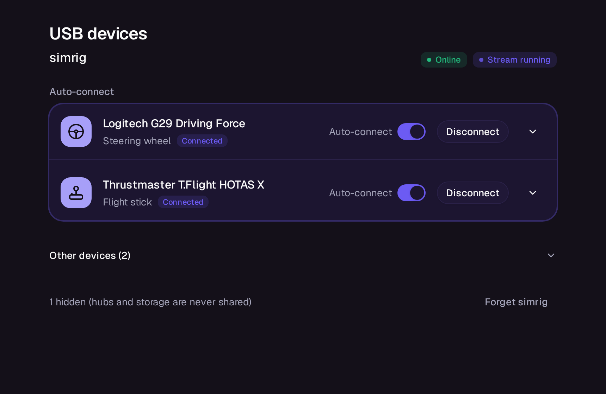
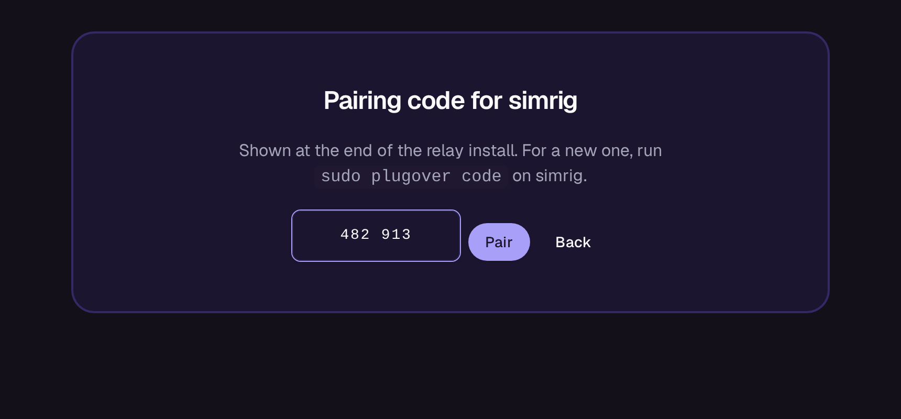

# Plugover

I stream games with [punktfunk](https://git.unom.io/unom/punktfunk), and my wheel and pedals are
plugged into a different machine than the one running the games. Plugover moves them over the
network for as long as a stream runs, then gives them back.

It uses USB/IP, so the host gets the actual USB device instead of an emulated gamepad. Force
feedback works, and so does anything else the device does over USB.



## How it fits together

There are two machines:

- the **relay** is the Linux box the devices are plugged into
- the **host** is the punktfunk host (Linux or Windows)

You pick which devices should auto-connect. When a stream starts they get plugged into the host,
if the connection drops they come back, and when the stream ends they go back to the relay.
Hubs and USB storage are never shared, so you can't accidentally hand over a disk.

## Install

Grab the files from the [latest release](https://github.com/wiktorekdev/plugover/releases/latest).

On the relay, unpack the tarball and run the installer as root. `--lan` opens the port and mDNS
for your network if you use plain nftables. With anything else, open TCP 7275 and UDP 5353 yourself.

```sh
sudo ./install.sh relay --lan 192.168.1.0/24
```

At the end it prints a pairing code. Keep it for a minute.

On a Linux host, unpack the same tarball and run it as your normal user:

```sh
./install.sh host
```

On a Windows host, in PowerShell:

```powershell
irm https://github.com/wiktorekdev/plugover/releases/latest/download/install.ps1 | iex
```

Then open the punktfunk console, go to **USB devices**, pick the relay and type in the code.
Flip **Auto-connect** on for the wheel, pedals or whatever else you want.



## Pairing

The relay usually has no screen, so pairing works with a six-digit code it prints. You get one at
the end of the install, and `sudo plugover code` gives you a fresh one later. Each code pairs one
host and stops working after 15 minutes.

The code never goes over the network: both sides use it for a SPAKE2 key exchange, so sniffing
the traffic doesn't help, and after five wrong guesses the relay stops accepting attempts.

One thing to know: once a device is connected, its traffic is regular unencrypted USB/IP.
That's fine at home, but don't run this across a network you don't trust.

## Command line

Everything in the console also works from a terminal:

```sh
plugover pair --code 482913    # pair with the relay on your network
plugover status                # what's paired and what's plugged in
plugover auto 046d:c24f on     # auto-connect a device (vendor:product)
plugover attach 1-2            # connect a device right now
sudo plugover code             # on the relay: new pairing code
```

## Building

You need Rust with the `x86_64-unknown-linux-musl` and `x86_64-pc-windows-gnu` targets,
`cargo-zigbuild` and bun. Then:

```sh
scripts/release.sh
```

## License

[MIT](LICENSE)
