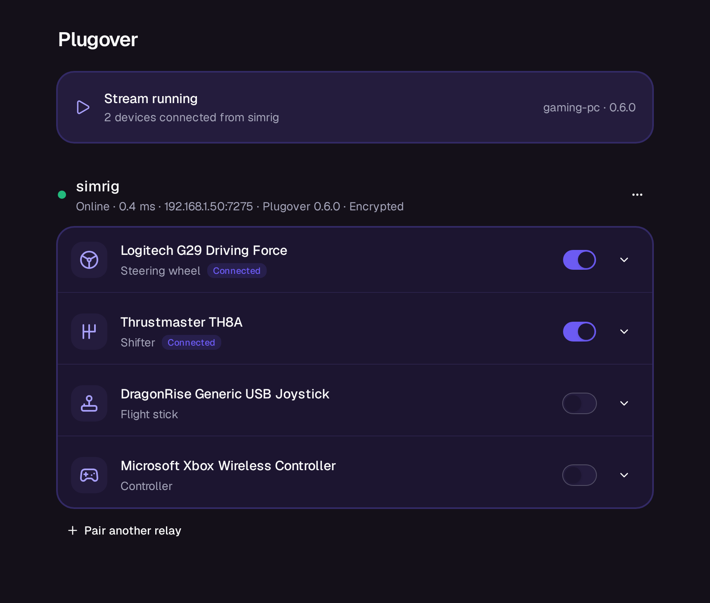
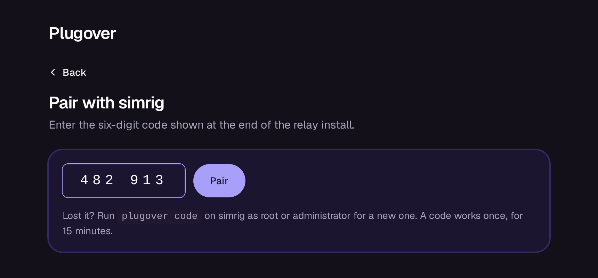

# Plugover

Use the racing wheel, pedals or controllers plugged into one computer on a
[punktfunk](https://git.unom.io/unom/punktfunk) host somewhere else on your network.

Plugover forwards the real USB device over USB/IP, not an emulated gamepad, so force feedback and
vendor features work as if the device were plugged into the gaming PC. Devices connect when a
stream starts and go back when it ends.



Everything between the two machines is encrypted, and only computers you paired with a one-time
code can connect.

## How it fits together


- The **relay** is the machine the devices are plugged into, usually next to the screen you stream
  to.
- The **host** is the gaming PC running punktfunk. Games there see the devices as if they were
  plugged in locally.

## Requirements

| | Relay | Host |
|---|---|---|
| **Linux** (x86_64, ARM64, ARMv7) | systemd, the `usbip-host` kernel module | systemd, the `vhci-hcd` kernel module, punktfunk-host |
| **Windows** (10 or 11, x64) | administrator rights; setup installs [usbipd-win](https://github.com/dorssel/usbipd-win) | administrator rights, punktfunk-host; setup installs [usbip-win2](https://github.com/vadimgrn/usbip-win2) |

Most Linux distributions ship both kernel modules. If setup says one is missing, install your
distribution's extra kernel modules (on Ubuntu: `linux-modules-extra-$(uname -r)`). Setup also loads
the kernel's `tls` module where there is one, so the kernel encrypts USB traffic; without it,
Plugover does that itself.

Both machines must be on the same network. The relay listens on TCP 7275 and announces itself over
mDNS (UDP 5353); setup opens both in the firewall for your network.

## Install

Run the installer on the relay first, then on the host.

**Linux**, as your normal user (it asks for sudo only for the steps that need root):

```sh
curl -fsSL https://github.com/wiktorekdev/plugover/releases/latest/download/installer.sh | sh
```

**Windows**, in PowerShell (it asks for administrator rights):

```powershell
irm https://github.com/wiktorekdev/plugover/releases/latest/download/installer.ps1 | iex
```

The installer shows its plan before changing anything and installs only what is missing.

1. **On the relay**, pick **Relay**. At the end it prints a six-digit pairing code.
2. **On the host**, pick **Host**.
3. **Pair.** Open the punktfunk console, go to **Plugover**, choose the relay and enter the code.
4. **Pick devices.** Turn on the ones you want. They connect whenever a stream runs; turning one off
   hands it back right away.



Lost the code? Run `sudo plugover code` on the relay (`plugover code` as administrator on Windows)
for a new one. A code works once, for 15 minutes.

### Other ways to install

- **Binary.** Download the file for your system from the
  [latest release](https://github.com/wiktorekdev/plugover/releases/latest) and run
  `plugover setup`, or double-click the `.exe` on Windows. The installer scripts do the same after
  checking the download against `SHA256SUMS`.
- **Debian package.** On Debian, Ubuntu and Raspberry Pi OS:
  `sudo apt install ./plugover_<version>_<arch>.deb`, then `plugover setup`. The package installs
  only the `plugover` command.
- **Without questions**, for scripts: pass the role and `--yes`.

  ```sh
  curl -fsSL https://github.com/wiktorekdev/plugover/releases/latest/download/installer.sh | sh -s -- --relay --lan 192.168.1.0/24,10.0.0.0/24 --yes
  plugover setup --host --yes
  ```

### Update and uninstall

- `plugover update` installs the newest release and keeps pairings and settings. It installs only a
  release signed with Plugover's release key. Update the relay and the host together; the console
  and `plugover status` say which one is behind.
- `plugover setup --uninstall` removes Plugover. On a computer that is both relay and host, add
  `--relay` or `--host` to remove only one. Add `--purge` to delete pairings and settings too.

## Using it

The **Plugover** page in the punktfunk console shows each paired relay, how quickly it answers and
the devices plugged into it. Turn a device on and it connects whenever a stream runs. Its details
let you:

- keep auto-connect to one port, when two of the same model are plugged in,
- fix a wrong name or device kind.

If a device cannot connect, its row says why.

Everything also works from a terminal on the host:

```sh
plugover status                          # paired relays, their devices and the link latency
plugover pair                            # find a relay on the network and pair with it
plugover auto 046d:c24f on               # connect a device whenever a stream runs
plugover auto 046d:c24f on --port 1-2    # only the one plugged into this port
plugover attach 1-2                      # connect a device now (plugover detach 1-2 to give it back)
plugover label 0fd9:0080 --name "Stream Deck" --kind other   # fix a name or kind
plugover forget simrig                   # remove a relay
plugover unencrypted simrig on           # connect a relay too old to encrypt anyway (see Security)
```

And on the relay, as root (or administrator on Windows):

```sh
plugover code                  # print a new pairing code
plugover hosts                 # list paired hosts
plugover unpair desktop        # remove a host; it loses its devices within a second
plugover share 046d:c24f on    # share only the devices you list
plugover share --all           # share everything again
```

Devices are identified by their USB id (`vendor:product`, shown by `plugover status`). Hubs, USB
storage and network adapters are never shared. Set `NO_COLOR=1` to turn off colored output.

## Compatibility

| System | Status |
|---|---|
| Linux relay and Linux host, x86_64 | **Tested** (Ubuntu 24.04 relay, EndeavourOS host) |
| Linux on ARM64 and ARMv7, such as a Raspberry Pi | Built, not tested yet |
| Windows relay or host | Built, not tested yet |
| Debian package | Built, not tested yet |

| Device | USB id | Status |
|---|---|---|
| Logitech G29 Driving Force | `046d:c24f` | **Tested** |

Anything that works over USB should work, but only what is listed has been tried. If Plugover
works, or doesn't, on your setup,
[send a compatibility report](https://github.com/wiktorekdev/plugover/issues/new?template=compatibility.md)
and it will be added here.

## Troubleshooting

Start with `plugover doctor` on both machines. It checks the setup and says what to fix.

```sh
plugover doctor            # check this machine
plugover logs -f           # follow the host daemon's log (add --relay for the relay's)
plugover doctor --report   # everything a bug report needs, as plain text
```

| Problem | What to do |
|---|---|
| The relay is not found | Check that it is on and that its firewall allows TCP 7275 and UDP 5353. You can also pair by address: `plugover pair 192.168.1.50`. |
| The relay shows as offline | Run `plugover doctor` on the relay. |
| A device does not connect | Its row in the console, `plugover status` and `plugover doctor` say why. |
| Right after installing the host on Linux, doctor says plugging devices in is not allowed | Log out and back in once; setup added you to the `punktfunk` group. |
| Force feedback stutters | Check the latency next to the relay. Wi-Fi is the usual cause; connect both machines by cable. |
| Setup says a kernel module is missing | See [Requirements](#requirements). |
| A relay "cannot encrypt, so its devices do not connect" | It runs Plugover older than 0.6. Update it; see [Security](#security). |
| A wheel stops after it switches modes | Plugover connects it again when it comes back on the same port within 20 seconds. If it stays off, turn on auto-connect for the new USB id too. |

Still stuck? [Open an issue](https://github.com/wiktorekdev/plugover/issues/new?template=bug_report.md)
with `plugover doctor --report` from both machines.

## Security

- **Pairing** uses a one-time code that never crosses the network: both sides use it for a SPAKE2
  key exchange. A code works once, for 15 minutes, and the relay stops accepting guesses after five
  wrong ones.
- **Every connection** to the relay proves it holds the key from pairing. A relay can unpair a host
  at any time, or share only the devices you list.
- **Everything is encrypted**, the device list and the USB traffic, with AES-128-GCM in TLS 1.3
  records and keys of its own for every connection. A record that was changed on the way ends the
  connection. On Linux the kernel encrypts USB traffic when it has its `tls` module, and Plugover
  does otherwise; `plugover doctor` says which.
- **Relays older than 0.6 cannot encrypt.** Their devices stay off until you update the relay or
  allow it with **Connect without encryption** in the console (`plugover unencrypted <relay> on`),
  after which the console marks it **Not encrypted**. A relay that encrypted once is never accepted
  unencrypted again, so nobody on the network can talk this host out of encrypting.
- **Updates** are checked against a signature: `plugover update` installs only releases whose
  `SHA256SUMS` is signed with the key in [packaging/release-key.pem](packaging/release-key.pem).

Report vulnerabilities privately; see [SECURITY.md](SECURITY.md).

## How it works

The relay lends devices with the kernel's `usbip-host` on Linux, or usbipd-win on Windows. The host
daemon keeps a connection to each paired relay, hears about plugs as they happen, and attaches the
chosen devices through `vhci-hcd` on Linux or usbip-win2 on Windows while a stream runs. The
punktfunk plugin tells the daemon when streams start and stop, and serves the console page.

On Linux, once a device is attached, its USB traffic runs entirely in the kernel on both machines,
encrypted by the kernel's TLS. Where the kernel cannot encrypt, and on Windows, it passes through
Plugover, which encrypts it on its way to the other machine.

What `plugover setup` installs:

| | Linux | Windows |
|---|---|---|
| **Relay** | `/usr/local/bin/plugover`, the `plugover-relay` service, the `usbip-host` module, firewall rules for your network (firewalld, ufw or nftables) | usbipd-win, a startup task, firewall rules that also block usbipd's own port (TCP 3240), so pairing is the only way in |
| **Host** | `~/.local/bin/plugover`, the `plugover-host` user service, the `vhci-hcd` module, the console plugin | usbip-win2, a startup task, the console plugin |

## Building from source

You need Rust with the `x86_64-unknown-linux-musl`, `aarch64-unknown-linux-musl`,
`armv7-unknown-linux-musleabihf` and `x86_64-pc-windows-gnu` targets, `cargo-zigbuild`, bun and
`dpkg-deb`.

```sh
scripts/build.sh                                # release files in dist/
scripts/deploy.sh <relay-ssh-host> <lan-cidr>   # build, set up the relay over ssh and the host here
cargo test                                      # also regenerates plugin/ui/src/generated/
```

| Path | What |
|---|---|
| `src/` | the `plugover` binary: relay, host daemon, command line, and the installer in `src/setup/` |
| `plugin/` | the punktfunk console plugin, built into the release binaries |
| `packaging/` | `installer.sh`, `installer.ps1` and templates for the Debian package and winget manifests |
| `data/catalog.toml` | friendly names for devices whose USB ids are unhelpful |

## Contributing

Bug reports, compatibility reports, questions and pull requests are all welcome as
[issues](https://github.com/wiktorekdev/plugover/issues). Most of the code was written with Claude
Opus 5.5.

## License

[MIT](LICENSE)
